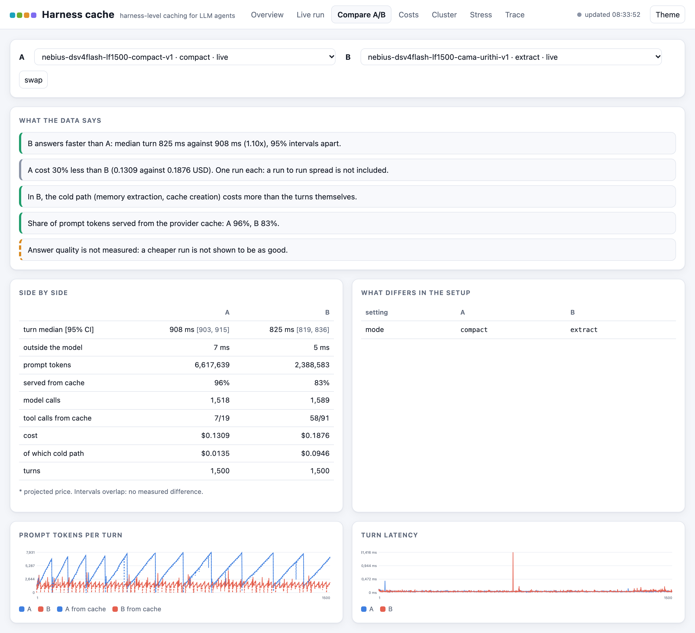

# Harness-Level Caching for LLM Agents

Private research code. Nothing here is published before a patent filing. The code is the
`harness_cache` package; runs and ledger events recorded before 2026-10-28 carry its former
name, cama, and the mode `cama` is read as `extract`.

A measurement study: what an LLM agent gains, in cost and latency, from caching in its own
harness (memory routing, embeddings, tool results, the prompt prefix sent to the provider),
and where it breaks. The deliverable is measured trade-offs and limits, not a product.

Where to read: design in `docs/architecture.md`, choices in `docs/decisions/`, results in
`docs/measured/` (generated), limits in `docs/limits.md`, existing work in
`docs/prior-art.md`, every action in `docs/ledger.jsonl` (rendered to `docs/journal/`).

## Main results so far

- `docs/measured/decisive-1500.md`: over 1500 turns on DeepSeek-V4-Flash the running summary
  recalls every fact and stays the cheapest arm; verbatim recall and the extracted memory
  with apu-urithi's routing also recall every fact, at a higher cost.
- `docs/measured/models-1500-*.md`: the same test on GLM-5.3, Gemini 3.5 Flash-Lite and
  Nemotron-3-Super. The share read from the provider's cache ranges from 2 to 96 percent
  with the model; on GLM-5.3 statement-triggered extraction was cheaper than the summary.
- `docs/measured/verbatim-search-1500.md`: EmbeddingGemma 2, or storing only messages that
  state a fact, makes verbatim recall find the right message; neither reduces its noise.
- `docs/measured/decisive.md` and `decisive-urithi.md`: the same comparison over 500 turns.
- `docs/measured/probes/`: Gemini's implicit cache gave 0 hits on 2026-10-27; provider
  caching cannot be assumed, it has to be measured.
- `docs/measured/web.md`: an exact-key tool cache rarely hits on model-written web queries.

## Reproduce the memory comparison

`scripts/reproduce.sh setup` fetches the embedding model and starts the container (Docker, uv
and `NEBIUS_API_KEY` in `.env`); `scripts/reproduce.sh <arm> [scenario]` runs one arm (`naive`,
`summary`, `verbatim`, `extract`, `extract-statements`) with the settings of the frozen runs and
prints its report. Try `/scenarios/generated/smoke_facts_100_v1.jsonl` first (100 turns).

## Install as a package

`[local]` adds the ONNX embedders; append `@<tag or commit>` to pin a version:

```bash
pip install "harness-cache[local] @ git+ssh://git@github.com/EZFRICA/harness-level-caching.git"
harness-cache --help
```

The price table is not in the package: point `HC_PRICING` to a copy of `pricing.toml`.

## Run it

```bash
cp .env.example .env                       # set the keys of the providers you use
HC_CODE_SHA=$(scripts/code_id.sh) docker compose up -d --build
```

The local embedding model (`qdrant/paraphrase-multilingual-MiniLM-L12-v2-onnx-Q`) is mounted
from `models/`, which is not in the repository: place the Hugging Face cache there. For
EmbeddingGemma 2 (`HC_EMBEDDER=gemma`), put the files of `onnx-community/embeddinggemma-2-ONNX`
in `models/embeddinggemma-2-onnx/`; in fp32 it needs most of 1 GB, so run one at a time or
raise `HC_MEM`. Limits of the container: `HC_CPUS` and `HC_MEM` (default 1 CPU and 1 GB).

```bash
docker compose exec -it hc harness-cache chat                            # interactive
docker compose exec hc harness-cache run /scenarios/assistant_fr_v1.jsonl --fresh --mode extract
docker compose exec hc harness-cache report /runs/<run_id>
```

Modes: `naive` (whole history), `compact` (running summary; `HC_VERBATIM_RECALL=on` adds
verbatim recall, with `HC_VERBATIM_STORE=statements` and `HC_VERBATIM_HISTORY=once`), `topk`
and `extract` (extracted memory, paged by a router). Each figure page in `docs/measured/`
gives the command that reproduces it. Long-session scenarios: `scripts/gen_long_facts.py`.

Dashboard: http://localhost:8797 (read only, live): runs, A/B comparison with verdicts, costs,
cluster, stress, ledger. Below, two 1500 turn runs: the running summary (A), whose prompt
grows and folds yet is mostly read from cache, against the extracted memory (B).



Cluster and stress: `./scripts/cluster_fresh.sh <run id>`, then `harness-cache load --workers
...`; `scripts/stress_scale.sh`, `scripts/fault_facts.py`, skill `run-a-stress`.

## Trace and figures

```bash
uv run pytest -q                           # offline, no key, no network
uv run harness-cache ledger add --kind action --title "..." --why "..." --result done
uv run harness-cache ledger check                   # the hash chain holds
uv run harness-cache figures snapshot runs/<run_id> # freeze a run into docs/measured/runs
uv run harness-cache figures write                  # regenerate the figure pages
uv run harness-cache decisions                      # every decision cites frozen runs and real tests
```

## Volumes

| volume | holds |
|---|---|
| `hc-data` at `/data` | SQLite stores, one per experiment with `--fresh` |
| `hc-archive` at `/archive` | the L4 replica fed by the cold path |
| `./runs` at `/runs` | manifest, turns, tasks and log of every run |
| `./scenarios` at `/scenarios` | scripted conversations, read only |
| `./models` at `/models` | the local ONNX embedding model, read only |
