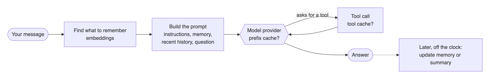
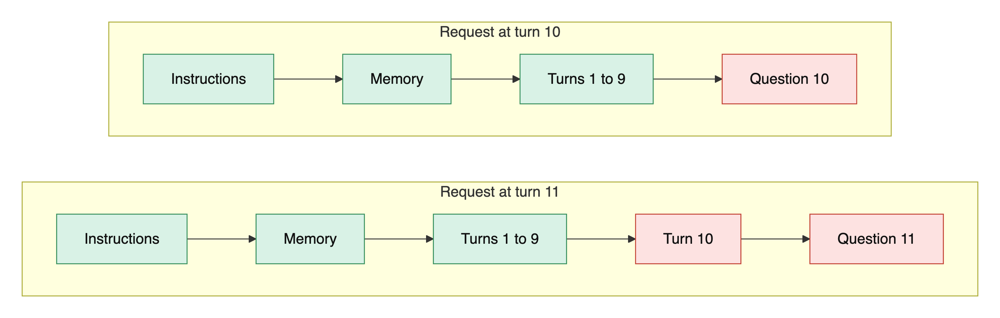
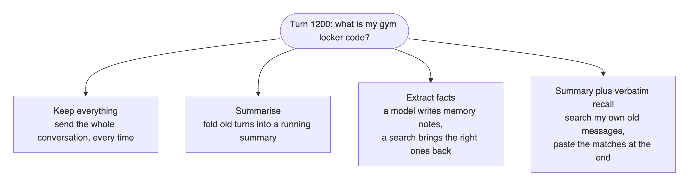
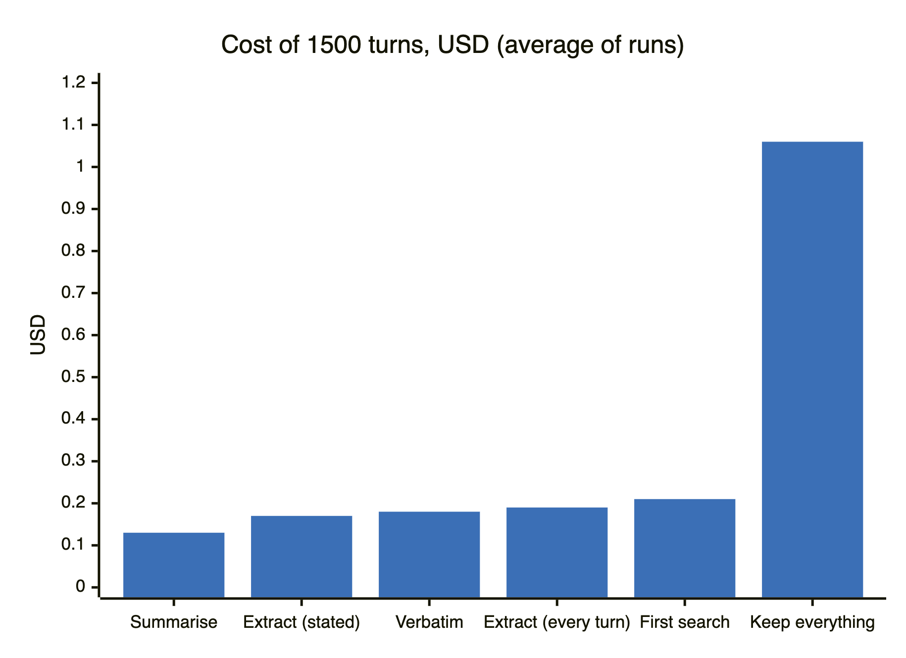

# What caching does for an LLM agent

*Notes from a few weeks of measuring memory, tool results and prompt caching in a long-running agent.*

Every time an agent answers you, it pays. It pays for the instructions it sends again, for the conversation it drags along, for the tools it calls, and sometimes for a second model call that tidies up its memory in the background. On a short chat that bill is tiny. Over hundreds or thousands of turns it is not.

So I asked a simple question: if I cache things inside the agent's own harness, the code around the model, how much do I actually save? And where does it stop working? I expected caching to win. It did not, at least not in the way I thought. This post is what I learned, with the numbers.

## Where the money goes in one turn

Here is what happens when you send a message to an agent like the one I built for these tests.

There are three places where a cache can help: the search that picks what to remember, the tool calls, and the prompt itself. The prompt is by far the biggest cost, so that is where most of this story happens.

## How a provider's prompt cache really works

I used to picture the provider's cache like Redis: you store something, you get it back later. It is not that. When a model reads your prompt, it does a lot of math for every token before it writes a single word. Providers keep the result of that math for a while. If your next request starts with exactly the same tokens, they skip that part and charge you much less for it. On DeepSeek V4 Flash at Nebius, a cached input token costs 0.01 USD per million instead of 0.14. That is fourteen times cheaper.

The catch is in the word "starts". The cache only works from the beginning of the prompt, and it stops at the first token that changed.

Green is reused, red is paid at full price. Put a timestamp at the top of your prompt, or reorder your memory notes, and everything after it turns red. You cannot read the cache, you cannot ask it what it holds, and it lives on whichever machine served your last request. If the next request lands on another machine, it is a miss.

## Surprise one: you cannot count on the cache being there

Some providers let you create a cache explicitly. Others, like Gemini's newest models, only cache implicitly: maybe, if you are lucky.

On October 24, Gemini 3.5 Flash-Lite did reuse a cached prefix after 15 seconds and after 2 minutes. Three days later I measured it again, carefully, through both the Gemini API and Vertex AI: 54 tests on one, 41 on the other, plus 20 calls sent two seconds apart. Not a single cached token. Same account, same kind of prompt.

At Nebius, on the other hand, the long-session runs below read about 95% of their input from cache. My takeaway: treat the provider's cache like the weather. Measure it on your own account before you build on it.

## Surprise two: caching tool results rarely hits

I also cached web search results. If the agent searches the same thing twice, why pay twice? Because the model almost never searches the same thing twice. It rephrases. With an exact match, the cache served 1 search out of 15 to 18 per run. I tried matching similar queries instead, and it found 2 more per run, but one match in four was wrong in a way that matters: a question about 2024 got an answer cached for 2025.

Tool caching is great for tools whose input the model does not write freely, like looking up a booking by its number. For free-text search, it barely helps.

## The big test: how should an agent remember?

Then the part I cared about most. I wrote a 1500 turn conversation with everyday chatter, and hid 24 personal facts in it: a locker code, a flight number, a doctor's name, a budget. Six of them get corrected later. Each fact is asked for between 100 and almost 1300 turns after it was last said, and an answer counts only if it gives the latest value. I compared four ways for the agent to remember.

"Extract facts" is the design I had spent the most time on. It keeps a small memory with a stable order, so the prompt stays cacheable, and it searches older notes when a question needs them. "Verbatim recall" was a last idea: no model writes notes, we simply search the user's own past messages and add the best matches at the end of the prompt, where they cannot break the cache. All runs used DeepSeek V4 Flash at Nebius, twice each except one.

| way to remember | facts recalled | cost of 1500 turns |
|---|---|---|
| Summarise | 24/24, 24/24 | **0.131 and 0.136 USD** |
| Extract facts, notes written only when a fact is stated | 24/24 (one run) | 0.173 USD |
| Summary plus verbatim recall | 24/24, 24/24 | 0.177 and 0.174 USD |
| Extract facts, notes after every turn | 24/24, 24/24 | 0.188 and 0.199 USD |
| Extract facts, with my first search | 21/24, 20/24 | 0.208 and 0.219 USD |
| Keep everything | 24/24, 24/24 | 0.97 and 1.16 USD |

The summary won: every fact recalled, and the lowest bill.

## Why the boring option wins

Keeping everything is fine for a while, because most of the history comes from the cache at a fourteenth of the price. But the prompt keeps growing. By turn 1500 every request carried 120,000 to 140,000 tokens, and the bill was seven to nine times the summary's.

The summary does one extra model call now and then, eleven or twelve times over the whole conversation, to fold old turns into a few bullet points. Between two folds the prompt only grows at the end, so the cache keeps working.

You can see it in the small dashboard I built to watch the runs. The blue line is the summary: the prompt grows, then drops back each time old turns get folded away. The red line is the extracted memory. It stays small, but it changes more often, so less of it comes from the cache (83% against 96%), and the notes it keeps writing in the background cost more than the answers themselves.

My fact extraction does its extra work much more often. Even when I only wrote notes for messages that state something, it cost about a third more than the summary. A small memory with a stable order does make each prompt cheaper. It just does not make up for the cost of keeping that memory up to date.

## What went wrong, and what fixed it

My first version lost three or four facts per run: a dentist appointment, a course, the corrected budget, and once a doctor's name. I assumed the memory had dropped them. It had not. They were stored, but the search that should bring them back stopped too early, at a weak match among the recent notes.

The fix came from an earlier project of mine: search the whole store for every question, mix keyword matching with embeddings, and use a different confidence threshold for each kind of note. With that search the memory recalled 24 out of 24 every time. Storing facts is the easy part. Finding them again is where memory systems fail.

## The verbatim idea, and why it cost more

Verbatim recall sounded like the best of both worlds: the summary's low cost, plus exact quotes from the user when a detail matters. It did recall everything. But the search found "something relevant" for almost every message, more than 1400 times out of 1500, and those pasted quotes made the history grow faster. The summary had to fold 24 or 25 times instead of 11 or 12, and every fold is a model call that also resets part of the cache.

A stricter search, or quotes that are sent once and not kept in the history, might fix that. I have not measured it yet, so I will not claim it.

## What I would tell someone building an agent

1. Measure your provider's cache on your own account before you design around it. It can change from one day to the next.
2. Keep the top of your prompt stable and put anything that changes at the end. That one habit does more than any clever cache.
3. Before you build a memory system, try a running summary. It is a hard baseline to beat, and I did not beat it on cost.
4. If you do build memory, spend your effort on the search, not the storage. Mix keywords with embeddings.
5. Cache tool results when the input is exact, like an id or a number. Do not expect much from caching free-text queries.

## What this does not show

These are honest but narrow results. The 1500 turn test ran on one model, twice per setup (once for one of them), on a conversation I generated. Recall means the exact fact appears in the answer; I did not grade answer quality otherwise. Other models, other providers, or real users could move the numbers. The full data, the code and every run are kept with the study, *Harness-Level Caching for LLM Agents*, so the numbers can be checked.

I started out wanting to show that a cache-aware memory beats a summary. I ended up learning why it does not, which turned out to be more useful.
